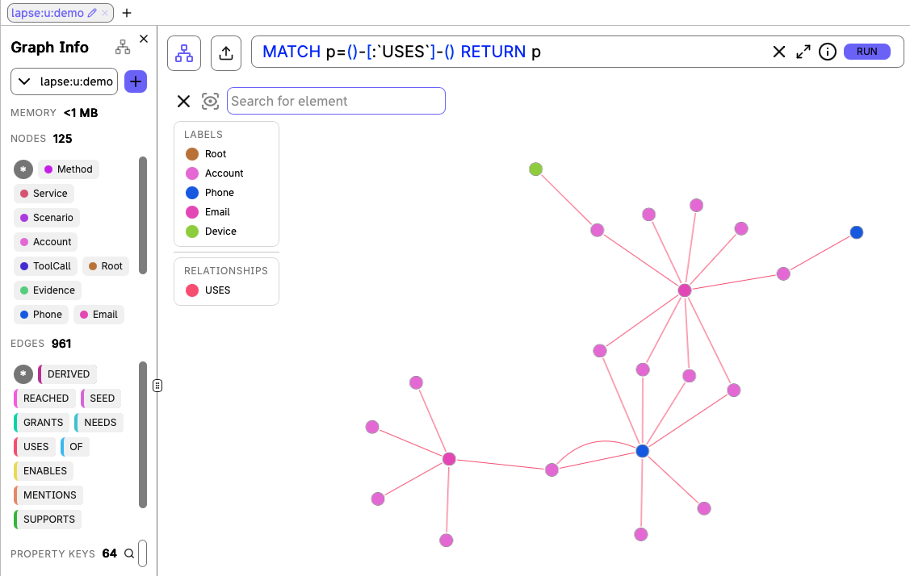
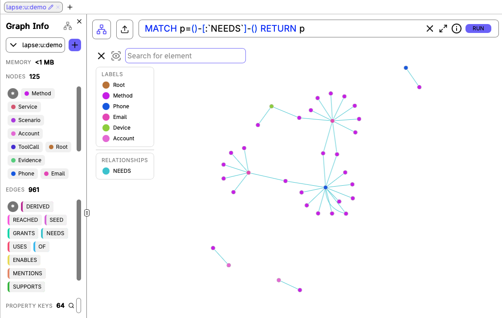

<p align="center">
  
</p>

# Lapse

**Know what you could lose. Fix the dependencies before you lose it.**

An old number can recover a mailbox. That mailbox can recover other accounts. **Lapse finds the whole chain**, explains the risk in Telegram, and plans fixes before you give up a number, inbox, or domain.

[](https://github.com/tejas-raskar/lapse/actions/workflows/ci.yml)

## What it does

- **Discover dependencies** from inbox evidence and explicitly declared contact/factor relationships.
- **Reason across multiple hops** about stranger takeover, immediate lockout, and lost recovery routes.
- **Explain each result** with the access methods, prerequisites, and evidence behind it.
- **Plan before acting:** simulate repairs in FalkorDB graph copies and order changes while old contacts still work.
- **Execute with approval:** supported browser actions, code relay, or guided manual steps; then keep watching for new risks.

Talk to it in Telegram; inspect the account map, plans, and agent activity in the web workspace.


## What is in the graph?

**Example control flow:** old phone → Google host account → primary mailbox → Notion account.

| Entity group | Nodes | What they represent |
| --- | --- | --- |
| Possession | `Root`: `Phone`, `Email`, `Domain`, `Device` | Numbers, mailboxes, domains, and devices you might lose. |
| Access | `Account`, `Method`, `Service` | An account, one way to access it, and the service policy behind it. |
| Evidence and monitoring | `Evidence`, `Signal`, `PolicyEvent` | Supporting message metadata, detected risks, and policy changes. |
| Reasoning and repair | `Scenario`, `Plan`, `Change` | A what-if result, a proposed repair plan, and its individual steps. |
| Agent context | `User`, `Turn`, `ToolCall` | User metadata, conversation history, and tool/query records. |
| Shared policy | `Service`, `MethodTemplate`, `ChangeProcedure`, `Carrier` | Service rules, access templates, change procedures, and reassignment rules. |

Shared policy lives in `lapse:policy`; each user's graph lives in `lapse:u:<uid>`. Queries never cross graphs.

### How the nodes connect

| Purpose | Relationships |
| --- | --- |
| Access requirements | `Method -NEEDS-> Root/Account`; `Method -GRANTS-> Account/Root` |
| Contacts and services | `Account -USES-> Root`; `Account -OF-> Service` |
| Evidence | `Evidence -SUPPORTS-> Account`; `Evidence -MENTIONS-> Root` |
| Monitoring | `Signal -ABOUT-> Root` |
| Scenario state | `Scenario -SEED-> Root`; `Scenario -REACHED-> Account/Root` |
| Explanations | `Account/Root -DERIVED-> prerequisite Account/Root` |
| Single-factor shortcuts | `Root/Account -ENABLES-> Account/Root` |
| Repair order | `Plan -HAS_STEP-> Change`; `Change -BEFORE-> Change`; `Change -FOR-> Account` |
| Agent memory | `Turn -ABOUT-> Account/Root`; `ToolCall -IN-> Turn` |
| Policy | `Service -HAS_METHOD-> MethodTemplate`; `Service -HAS_CHANGE-> ChangeProcedure` |

**OR between methods; AND within a method.** Any method can grant access, but only if **all** its `NEEDS` are controlled. The user knows passwords; a stranger does not. `USES` records a contact dependency, not proof of access.

**Contact dependencies (`USES`)**



**Access requirements (`NEEDS`)**



[Full schema and semantics →](docs/data-model.md)

## What traversals does Lapse use?

| Question | Graph operation | Why it matters |
| --- | --- | --- |
| **What can a stranger reach?** | Repeated [`NEEDS`/`GRANTS` closure](lapse/graph/queries/closure_round.cypher). | Checks complete prerequisite sets, not just connected nodes; advances until no new target is controlled. |
| **What if I lose this contact?** | [Before/after closure comparisons](lapse/graph/scenarios.py), with and without password knowledge. | Separates accounts lost now from accounts losing password-free recovery. |
| **Why is this account affected?** | Follow [`DERIVED`](lapse/graph/queries/explain.cypher) from target to prerequisites; retrieve `SUPPORTS`/`MENTIONS` evidence. | Preserves every prerequisite branch, including AND methods. |
| **What is the shortest route?** | `algo.SPpaths` over `ENABLES`. | Finds shortest password-free, single-factor routes. |
| **Which dependency is a hub?** | `algo.betweenness` plus bounded upstream/downstream traversals over `ENABLES`. | Estimates centrality; ranks by upstream-source × downstream-account counts. |
| **What should I fix first?** | [`GRAPH.COPY` simulations](lapse/graph/planner.py), contact changes, recompilation, and exposure reevaluation. | Tests repairs before proposing ordered steps, rather than guessing from an account list. |

`ENABLES` covers only password-free, single-prerequisite methods, so its algorithms give **lower bounds**; no single-factor route does **not** mean safe. The LLM picks fixed tools and **never writes Cypher**.

### Reproducible demo results

Synthetic backend fixture results, **under the methods we model**:

| Scenario | Verified result |
| --- | --- |
| Stranger gets the old number | <!-- claim:takeover_phone_old.direct -->5<!-- /claim --> accounts directly reachable → <!-- claim:takeover_phone_old.full -->10<!-- /claim --> across the full chain; <!-- claim:takeover_phone_old.unknown -->1<!-- /claim --> unknown. |
| College inbox closes | <!-- claim:lockout_email_college.lost_now -->1<!-- /claim --> account lost immediately; <!-- claim:lockout_email_college.recovery_lost -->4<!-- /claim --> lose recovery. |
| Simulate replacing the old number | <!-- claim:plan_phone_old.before -->11<!-- /claim --> distinct affected accounts → <!-- claim:plan_phone_old.after -->0<!-- /claim --> projected, across <!-- claim:plan_phone_old.steps -->7<!-- /claim --> proposed steps. |

The plan counts takeover and lockout exposure together, hence 11. Projections are not execution. [Reproduce the claims →](docs/claims.md)

## Run locally

Requires **Docker Compose v2**, **Python 3.12 + [uv](https://docs.astral.sh/uv/)**, a Telegram bot token, an OpenAI-compatible LLM key, and IMAP inbox access.

```sh
git clone https://github.com/tejas-raskar/lapse.git
cd lapse
uv sync --extra browser
cp -n .env.example .env
cp -n persona.local.example.yaml persona.local.yaml
make keys
# Edit both local files: generated keys, Telegram, LLM, inboxes, and matching roots.
# Keep LAPSE_UID=demo for the commands below.
make up
uv run python -m lapse.onboarding --uid demo
make demo
```

Open the **[workspace](http://localhost:8080)** → **Connections** to discover inbox accounts and link Telegram. FalkorDB Browser is at **[localhost:3001](http://localhost:3001)**. [Configuration and troubleshooting →](docs/deploy.md)

## References

[Setup](docs/deploy.md) · [Graph model](docs/data-model.md) · [Named queries](lapse/graph/queries) · [Tools and MCP](docs/tools.md) · [Execution support](docs/exec-notes.md) · [Contributing](AGENTS.md)

**Scope:** experimental. Unmodelled services are **unknown, not safe**; SSO is not modelled. Only the personal, unmanaged Notion email change is live-validated. [Policy limits →](docs/policy-notes.md)
